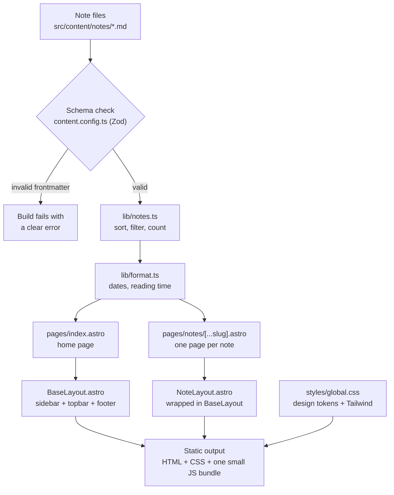
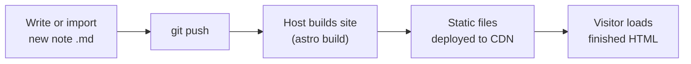
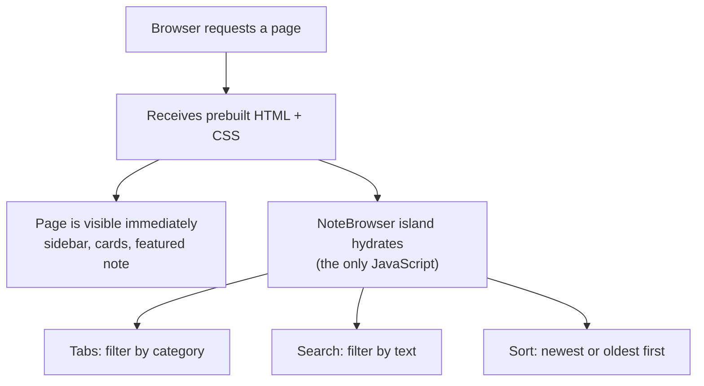

# Architecture Decisions

This document details the architectural decisions, trade-offs, and design patterns for leetnotes, a static personal engineering journal.

--- 

## Architectural Drivers
* **Read-Heavy Access Pattern:** Content is static and read-only; no user accounts, live comments, or dynamic server processing are required.
* **Zero-Maintenance Infrastructure:** Minimal operational burden. No server runtimes, no database dependencies, and low hosting costs.
* **Frictionless Content Authoring:** Local-first Markdown authoring with automatic deployment via Git workflows.

---

## Architectural Decisions

### ADR-01: Framework Selection — Static Site Generation (SSG)
* **Status:** Accepted
* **Context:** The application serves purely static technical documentation.
* **Decision:** Use Astro as the core build system.
* **Rationale:** Pre-rendering every route to static HTML at build time avoids runtime server load. Astro delivers zero client-side JavaScript by default on reading pages, maximizing Core Web Vitals performance. This is sufficient for an initial release.

### ADR-02: Persistence — File-Based Content Store
* **Status:** Accepted
* **Context:** A full database introduces deployment complexity, maintenance overhead, and hosting expense.
* **Decision:** Store all entries as flat Markdown files (`src/content/notes/`) managed directly in Git.
* **Rationale:** Git serves as a transparent version history store. Content management requires no operational database, while backup and portability remain trivial.

### ADR-03: Quality Control — Build-Time Schema Validation
* **Status:** Accepted
* **Context:** Frontmatter metadata errors (e.g., missing tags, bad date formats) lead to broken rendering in production.
* **Decision:** Enforce note metadata contracts using Astro Content Collections powered by Zod schemas (`content.config.ts`).
* **Rationale:** Schema validation runs during `astro build`. Any schema violation immediately aborts the build with an explicit error, preventing broken releases.

```yaml
title: Two Sum, and the case for a hash map
summary: Starting with the obvious solution...
category: algorithm        # algorithm | system-design | low-level-systems
tags: [Arrays, Hash maps]
date: 2026-10-10
featured: true
```

### ADR-04: Client Interactivity — Islands Architecture
* **Status:** Accepted
* **Context:** Global search, tag filtering, and sorting require real-time client-side behavior.
* **Decision:** Isolate interactive state inside a single React component (`NoteBrowser.tsx`) using island hydration (`client:load`).
* **Rationale:** Hydrating only the search and filter component keeps the surrounding page layout light, purely static, and zero-JS.

---

## System Structure & Data Access

| Layer / File | Responsibility |
| --- | --- |
| `src/content/notes/*.md` | Source notes and raw frontmatter metadata |
| `content.config.ts` | Type safety and build-time validation gatekeeper |
| `lib/notes.ts` | Centralized data query abstraction (sorting, filtering, counting) |
| `layouts/BaseLayout.astro` | Structural page shell (sidebar, topbar, footer) |
| `components/notes/NoteBrowser.tsx` | Hydrated UI island handling instant text search and tag filters |
| `layouts/BaseLayout.astro` | Page shell shared by every page |
| `layouts/NoteLayout.astro` | Reading view for a single note |
| `pages/index.astro` | Home: featured note and the notes list |
| `pages/category/[category].astro` | Category views for coding problems, system design, and low-level systems |
| `pages/notes/[...slug].astro` | Generates one page per note at build time |
| `components/notes/NoteBrowser.tsx` | Interactive tabs, search, and sort |
| `lib/notes.ts` | Single place for querying and counting notes |
| `lib/format.ts` | Date formatting and reading-time calculation |

---
## Folder structure

```
leetnotes/
├─ astro.config.mjs
├─ package.json
├─ tsconfig.json
├─ public/
│  └─ favicon.svg
└─ src/
   ├─ content.config.ts        # note schema
   ├─ content/
   │  └─ notes/
   │     ├─ two-sum.md
   │     ├─ rate-limiter.md
   │     └─ ...
   ├─ layouts/
   │  ├─ BaseLayout.astro      
   │  └─ NoteLayout.astro      
   ├─ pages/
   │  ├─ index.astro           # home page
   │  ├─ category/[category].astro # dynamic category views
   │  ├─ notes/[...slug].astro # one page generated per note
   │  └─ 404.astro
   ├─ components/
   │  ├─ layout/
   │  │  ├─ Sidebar.astro
   │  │  ├─ Topbar.astro      # breadcrumb + status line
   │  │  └─ Footer.astro
   │  ├─ notes/
   │  │  ├─ FeaturedNote.astro
   │  │  ├─ NoteCard.astro
   │  │  └─ NoteBrowser.tsx   # island: tabs + search + sort
   │  └─ ui/
   │     ├─ Tag.astro
   │     └─ CategoryLabel.astro
   ├─ lib/
   │  ├─ notes.ts              # fetch/sort/count helpers
   │  └─ format.ts             # dates, reading time
   └─ styles/
      └─ global.css            # design tokens: colors, fonts
```

## Architecture Diagrams

### Build time: from Markdown to static site



### Publishing: from new note to live site



### Runtime: visitor view


